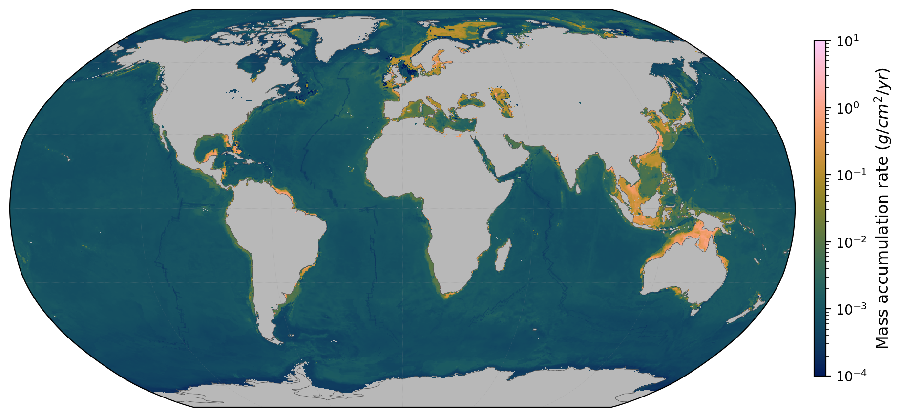

# MTL-MAR: Global Prediction of Mass Accumulation Rates Using Multi-Task Learning

[](https://doi.org/10.5281/zenodo.18591773)

<p align="center">
  
</p>
<p align="center"><em>Global seafloor sediment mass accumulation rate (MAR) from the selected multi-task learning model.</em></p>

**Companion code for:**
> Parameswaran, N., Burwicz-Galerne, E., Gonzalez, E., Braack, M., & Wallmann, K.
> *Global Prediction of Mass Accumulation Rates of Sediments and Organic Carbon Turnover Using Multi-Task Learning.*
> Global Biogeochemical Cycles (2026).

---

## What does this code do?

This repository contains all the code used to produce the global maps of
**marine mass accumulation rate (MAR)** and **total organic carbon (TOC)**
presented in the paper. Starting from 113 environmental input layers
(bathymetry, ocean temperature, sediment thickness, wave climate, etc.)
and ~13,000 MAR measurements from sediment cores, the code trains machine
learning models that predict MAR at every 5′ × 5′ ocean grid cell worldwide.

Nine different model types are compared; the best-performing model is a
**multi-task learning (MTL) neural network** that predicts MAR and TOC
simultaneously. All models, evaluation plots, and global prediction maps
can be reproduced from this repository.

---

## Table of Contents

1. [What you need before starting](#what-you-need-before-starting)
2. [How the code is organised](#how-the-code-is-organised)
3. [Getting started — step by step](#getting-started--step-by-step)
4. [The five-step workflow (how to reproduce everything)](#the-five-step-workflow)
5. [What each model is and where to find it](#what-each-model-is-and-where-to-find-it)
6. [What outputs and figures are produced](#what-outputs-and-figures-are-produced)
7. [How to retrain the models with new data](#how-to-retrain-the-models-with-new-data)
8. [Quick-update pipeline (for adding a few new cores)](#quick-update-pipeline)
9. [Notes on reproducibility](#notes-on-reproducibility)
10. [License](#license)

---

## What you need before starting

| Requirement | What it is | How to check |
|---|---|---|
| **Python 3.9+** | The programming language the code is written in | Type `python --version` in a terminal |
| **pip** | Python's package installer (comes with Python) | `pip --version` |
| **Jupyter Notebook** | An interactive environment for running code in step-by-step cells; all analysis is done in notebooks (`.ipynb` files) | `jupyter --version` |
| **A terminal** | The text-based command prompt on your computer (called *Terminal* on Mac/Linux, *Command Prompt* or *Anaconda Prompt* on Windows) | — |
| **GPU *(recommended)*** | A graphics processing unit; the neural network models train much faster with one (NVIDIA GPU with CUDA) | `nvidia-smi` |
| **SLURM *(optional)*** | A job scheduler found on many university computing clusters; lets you submit long-running training jobs to a shared machine | `squeue --version` |

> **No GPU or cluster?** All models can also be run on a regular laptop
> (slower for neural networks, but the tree-based models finish within hours).

---

## How the code is organised

The repository has four main folders. Think of them as:

```
mtl-mar/
│
├── notebooks/      ← START HERE: Jupyter notebooks that walk you through
│                     each step, from data preparation to model training
│
├── scripts/        ← Helper programs called by the notebooks (you rarely
│                     need to open these directly)
│
├── src/            ← Reusable code libraries that the notebooks and scripts
│                     import behind the scenes
│
├── pipeline/       ← A shortcut for quick updates: add new observations
│                     and retrain tree-based models in one command
│
├── data/           ← All data files (downloaded separately — see below)
│
├── docs/           ← Additional documentation
│
└── _archive/       ← Older code versions kept for reference (not needed)
```

### What is in `notebooks/`?

Each notebook corresponds to one step in the workflow. They are meant to
be opened in Jupyter and run cell by cell (or all at once).

| Notebook | Purpose |
|----------|---------|
| `collect_SR_MAR_datapoints.ipynb` | **Step 1.** Gathers all the MAR and TOC measurements from raw databases into clean tables |
| `create_training_features_CS.ipynb` | **Step 2a.** For each continental-shelf measurement site, extracts the 113 environmental values (temperature, depth, sediment thickness, etc.) |
| `create_training_features_DO.ipynb` | **Step 2b.** Same as above, but for deep-ocean sites |
| `modify_features.ipynb` | *(Optional)* Add, remove, or rename environmental input layers |
| `Make_Global_Features.ipynb` | **Step 3.** Builds the global 5′ × 5′ grid of all 113 environmental layers used for prediction |
| `nn_feature_cross_imputation.ipynb` | **Step 4.** Fills gaps in the environmental grids (e.g., missing data under sea ice or clouds) using a neural network |
| `train_tree_based_models.ipynb` | **Step 5.** Trains Random Forest, XGBoost, and CatBoost models |
| `train_knn.ipynb` | **Step 5.** Trains the k-Nearest Neighbors model |
| `train_tabpfn.ipynb` | **Step 5.** Runs the pre-trained TabPFN model |
| `train_neural_network.ipynb` | **Step 5.** Trains a feed-forward neural network (FFNN) |
| **`train_multi_task_learning.ipynb`** | **Step 5. ★ This is the main model** — trains the MTL neural network that predicts MAR and TOC together |
| `train_neural_network_attention.ipynb` | **Step 5.** Trains an attention-based neural network variant |
| `train_multi_task_learning_attention.ipynb` | **Step 5.** Trains an attention-based MTL variant |
| `run_models_on_new_data.ipynb` | A guided checklist for retraining when you have new data |

**Helper files** (you do not need to open these — the notebooks use them automatically):
- `run_all_models.sh` — a shell script that submits all training jobs to a computing cluster at once
- `batchfiles/` — individual cluster job scripts for each model

### What is in `scripts/`?

These are standalone programs for the ocean-gap filling step (Step 4).
The two most important ones are:

| Script | Purpose |
|--------|---------|
| `harmonize_ocean_gaps.py` | Fills missing values in the environmental grids using a neural-network method (described in the paper, Section 2.1 and Supporting Information Text S1) |
| `build_masked_model_features.py` | Assembles the final training arrays that the models will use |

Full details: [`scripts/README_NN_IMPUTATION.md`](scripts/README_NN_IMPUTATION.md)

### What is in `src/`?

Library code imported by the notebooks. Organised into three subfolders:

- **`preprocessing/`** — code for reading environmental raster files, building training feature tables, and computing spatial averages
- **`models/`** — the actual model training and prediction logic (neural networks, tree-based models)
- **`postprocessing/`** — code for evaluating model performance (error metrics, scatter plots, global map visualisation, NetCDF export)

### What is in `data/`?

All data files. **This folder is not included in the repository download**
because the files are too large; you must download them separately from Zenodo (see below).

```
data/
├── raw/            ← Original input data (from Zenodo)
│   ├── features/   ← 113 environmental raster layers (NetCDF/GRD files)
│   ├── labels/     ← MAR and TOC measurement tables (CSV files)
│   └── island_map.npy  ← Land/ocean mask
│
├── interim/        ← Intermediate files created during processing
│   ├── inputfeatures/   ← Feature arrays at measurement sites
│   ├── worldfeatures/   ← Feature arrays for the full global grid
│   └── masks/           ← Which grid cells had missing data
│
└── output/         ← Final results
    ├── predictionmaps_SedRate/  ← Global MAR maps (images + data files)
    └── model_metrics/           ← Performance numbers (MAE, R², etc.)
```

---

## Getting started — step by step

### Step 1: Download the code

Open a terminal and type:

```bash
git clone https://github.com/paramnav/mtl-mar.git
cd mtl-mar
```

> **What does this do?** `git clone` downloads a copy of the entire
> code repository to your computer. `cd` ("change directory") moves
> into the downloaded folder.

### Step 2: Install Python packages

```bash
pip install -r requirements.txt
```

> **What does this do?** `pip install -r requirements.txt` reads the
> file `requirements.txt` (which lists all the software libraries
> this project needs — NumPy, PyTorch, scikit-learn, etc.) and installs
> them automatically.

### Step 3: Download the data

The environmental raster layers and observation labels are archived on Zenodo.

```bash
python setup_project.py
```

> **What does this do?** This script downloads the data files from
> Zenodo and places them in the correct `data/` subfolders. It may
> take a while depending on your internet connection (several GB).
> See [`README_DATA_DOWNLOAD.md`](README_DATA_DOWNLOAD.md) for manual
> download instructions if the script does not work.

### Step 4: Open a notebook

```bash
jupyter notebook
```

> **What does this do?** This opens the Jupyter Notebook interface in
> your web browser. Navigate to the `notebooks/` folder and open any
> `.ipynb` file. Each notebook contains explanatory text alongside
> the code — you can run it cell by cell using `Shift + Enter`.

---

## The five-step workflow

To reproduce every result from scratch, run the notebooks **in order**.
Each step builds on the outputs of the previous one.

### Step 1 — Collect measurement labels

> **Notebook:** `notebooks/collect_SR_MAR_datapoints.ipynb`

Reads the raw MAR and TOC observation databases and creates clean
tables of measurement sites with their coordinates and values.

### Step 2 — Build site features

> **Notebooks:** `notebooks/create_training_features_CS.ipynb` and
> `notebooks/create_training_features_DO.ipynb`

For each measurement site, reads the 113 environmental layers
(ocean temperature, seafloor depth, sediment thickness, wave height, etc.)
and extracts the value at that location. This produces the
"training data" — a table where each row is one site and the columns
are the environmental values plus the measured MAR.

- **CS** = continental shelf sites (water depth ≤ 200 m)
- **DO** = deep ocean sites (water depth > 200 m)

### Step 3 — Build global feature grids

> **Notebook:** `notebooks/Make_Global_Features.ipynb`

Resamples all 113 environmental layers onto a common 5-arc-minute
(~9 km) global ocean grid. This is the grid on which the trained
models will make predictions.

### Step 4 — Fill ocean gaps (neural network imputation)

> **Run from a terminal** (GPU recommended):
> ```bash
> python scripts/harmonize_ocean_gaps.py
> python scripts/build_masked_model_features.py
> ```
>
> Or use the notebook: `notebooks/nn_feature_cross_imputation.ipynb`

Some environmental layers have missing values over parts of the ocean
(for example, ocean colour is missing under persistent cloud cover or sea ice).
This step fills those gaps using a neural network that learns
relationships between the environmental variables. The method is
described in the paper (Section 2.1) and Supporting Information (Text S1).

### Step 5 — Train models and produce maps

> **Notebooks:** any of the `notebooks/train_*.ipynb` files, **or**
> submit all at once with:
> ```bash
> bash notebooks/run_all_models.sh
> ```

Each training notebook:
1. Loads the prepared feature tables from Steps 2–4
2. Splits the data into training (75%) and testing (25%) sets
3. Trains the model
4. Evaluates performance (error metrics, scatter plots)
5. Predicts MAR at every ocean grid cell and saves a global map

---

## What each model is and where to find it

| Model | What it is | Notebook | Key setting |
|-------|------------|----------|-------------|
| **Random Forest** | An ensemble of many decision trees that each vote on the prediction | `train_tree_based_models.ipynb` | 700 trees |
| **XGBoost** | A boosted tree model where each tree corrects the mistakes of the previous one | `train_tree_based_models.ipynb` | 1000 trees |
| **CatBoost** | A variant of boosted trees designed for categorical and numerical data | `train_tree_based_models.ipynb` | 1000 trees |
| **k-NN** | Predicts MAR by averaging the k nearest measurement sites in feature space | `train_knn.ipynb` | k = 6 neighbours |
| **TabPFN** | A pre-trained neural network for tabular data; no hyperparameter tuning needed | `train_tabpfn.ipynb` | Default settings |
| **FFNN** | A feed-forward (fully connected) neural network | `train_neural_network.ipynb` | 3 hidden layers, 128 neurons each |
| **MTL ★** | **Selected model.** A multi-task learning neural network that predicts MAR and TOC simultaneously, sharing information between both tasks | `train_multi_task_learning.ipynb` | 4 hidden layers (128 neurons), first 2 shared |
| **FFNN + attention** | A neural network with an attention mechanism that can weigh the importance of each input feature | `train_neural_network_attention.ipynb` | 3 attention layers |
| **MTL + attention** | Combines multi-task learning with the attention mechanism | `train_multi_task_learning_attention.ipynb` | 2 attention layers |

> **Which model should I use?** For the best global MAR map, use the **MTL** model
> (`train_multi_task_learning.ipynb`). It was selected because it has strong
> prediction accuracy *and* its global sediment budget (28.1 Pg yr⁻¹) falls
> within the independent particle-flux compilation range (17.6–32.2 Pg yr⁻¹).

---

## What outputs and figures are produced

After running the training notebooks, you will find the following under `data/output/`:

| Output | What it shows | Where to find it |
|--------|---------------|------------------|
| **Global MAR maps** | Robinson-projection world maps of predicted MAR for each model (PNG images) | `data/output/predictionmaps_SedRate/paper_table2/maps_paper_png/` |
| **Scatter plots** | Measured vs. predicted MAR for training and testing data (how well each model fits) | `data/output/predictionmaps_SedRate/paper_table2/scatters/` |
| **Hyperparameter curves** | How model performance changes as settings are tuned (e.g., number of trees) | `data/output/predictionmaps_SedRate/hyperparameter_optimization/` |
| **Raw prediction grids** | NumPy (`.npy`) arrays of the global prediction — useful for further analysis | `data/output/predictionmaps_SedRate/paper_table2/` |
| **Model uncertainty** | MC-dropout uncertainty and information-gain maps (produced by the MTL notebook) | Saved by the MTL notebook |
| **Performance metrics** | Numeric results: MAE, correlation coefficient, R², global sediment budget | `data/output/model_metrics/` and printed inside each notebook |

---

## How to retrain the models with new data

If you have **new sediment-core measurements** (new MAR or TOC values),
or if any of the **environmental raster layers have been updated**,
follow this recipe:

### Recipe: Retrain everything with new data

1. **Update the observation tables.** Add your new measurements to the
   raw label files, then re-run `notebooks/collect_SR_MAR_datapoints.ipynb`
   to rebuild the clean observation tables.

2. **Rebuild the site features.** Run
   `notebooks/create_training_features_CS.ipynb` and
   `notebooks/create_training_features_DO.ipynb`
   so each site gets the correct environmental values.

3. **Rebuild the global grids** *(only if rasters changed).* Run
   `notebooks/Make_Global_Features.ipynb`.

4. **Re-fill ocean gaps.** Open a terminal and run:
   ```bash
   python scripts/harmonize_ocean_gaps.py
   python scripts/build_masked_model_features.py
   ```
   This is the most time-consuming step; a GPU is recommended.

5. **Retrain all models.** Either:
   - Open each `train_*.ipynb` notebook and run it, **or**
   - Submit all jobs to a computing cluster in one command:
     ```bash
     bash notebooks/run_all_models.sh
     ```

6. **Check results.** Open the scatter plots and maps in `data/output/`.

> **Detailed guide:** [`docs/RETRAINING_WITH_NEW_DATA.md`](docs/RETRAINING_WITH_NEW_DATA.md)
> contains the full operator notes with SLURM commands and troubleshooting.

### Shortcut: Reproduce the exact paper results without retraining

If you just want the published Table 2 products (same data, same models):

```bash
python notebooks/reproduce_paper_table2.py
```

---

## Quick-update pipeline

If you only want to **add a small number of new cores** and quickly
retrain the tree-based models (Random Forest, XGBoost, CatBoost, k-NN),
there is a simplified pipeline that does not require re-running all
the notebooks:

```bash
# 1. Add new observations (original data files are not modified)
python pipeline/add_data.py --dataset MAR_CS --csv new_points.csv

# 2. Retrain models and produce maps (one command)
python pipeline/run_pipeline.py
```

This pipeline:
- Extracts features at the new sites
- Runs a hyperparameter search (tests different model settings to find the best)
- Trains the selected models
- Produces new global prediction maps

Results go into `pipeline/output/` (separate from the main results in `data/output/`).

Common options:

| Option | What it does |
|--------|--------------|
| `--use-existing-features` | Skip feature extraction if the environmental grids have not changed (faster) |
| `--skip-hp-sweep` | Use the published model settings instead of searching for new ones |
| `--dnn` | Also train a neural network (off by default in the quick pipeline) |
| `--target MAR` | Retrain only the MAR models (skip TOC) |

See [`pipeline/README.md`](pipeline/README.md) for all options.

---

## Notes on reproducibility

- **Identical results** require the same hardware. The neural network
  results in the paper were produced on **NVIDIA H100 GPUs**. Running on
  a different GPU (e.g., V100 or A100) may give slightly different numbers
  due to differences in floating-point arithmetic.

- **Random seed:** All train/test splits and model initialisations use a
  fixed random seed (42), so re-running on the same hardware gives the same
  output.

- **Tree-based models** (Random Forest, XGBoost, CatBoost, k-NN) are
  hardware-independent and will produce identical results on any machine.

---

## License

This project is licensed under the **MIT License** — you are free to use,
modify, and redistribute the code. See the full text below.

<details>
<summary>Full MIT License text</summary>

Permission is hereby granted, free of charge, to any person obtaining a copy
of this software and associated documentation files (the "Software"), to deal
in the Software without restriction, including without limitation the rights
to use, copy, modify, merge, publish, distribute, sublicense, and/or sell
copies of the Software, and to permit persons to whom the Software is
furnished to do so, subject to the following conditions:

The above copyright notice and this permission notice shall be included in all
copies or substantial portions of the Software.

THE SOFTWARE IS PROVIDED "AS IS", WITHOUT WARRANTY OF ANY KIND, EXPRESS OR
IMPLIED, INCLUDING BUT NOT LIMITED TO THE WARRANTIES OF MERCHANTABILITY,
FITNESS FOR A PARTICULAR PURPOSE AND NONINFRINGEMENT. IN NO EVENT SHALL THE
AUTHORS OR COPYRIGHT HOLDERS BE LIABLE FOR ANY CLAIM, DAMAGES OR OTHER
LIABILITY, WHETHER IN AN ACTION OF CONTRACT, TORT OR OTHERWISE, ARISING FROM,
OUT OF OR IN CONNECTION WITH THE SOFTWARE OR THE USE OR OTHER DEALINGS IN THE
SOFTWARE.
</details>
